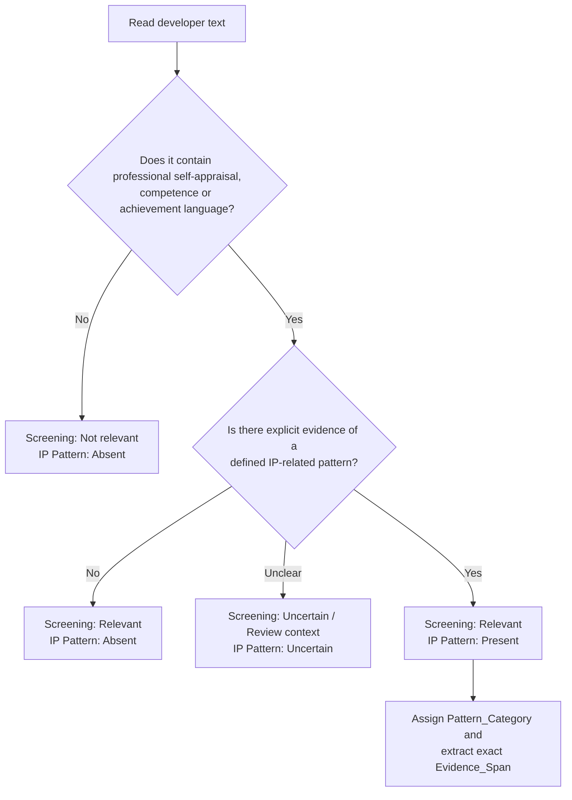

# DevForward: Impostor Phenomenon (IP) Linguistic Annotation Guidelines (v1.0)

**Project:** DevForward — NLP-Based Identification of Impostor-Related Linguistic Patterns in Software Developer Communications  
**Theoretical Framework:** Clance Impostor Phenomenon Scale (CIPS)  
**Target Datasets:** Senti4SD (Stack Overflow communications) and supplementary developer reflections

---

## 1. Research Task Definition

The objective of this annotation task is to identify **Impostor Phenomenon (IP)–related linguistic patterns** in written communications and reflections authored by software developers.

Unlike standard sentiment polarity classification (positive, negative, or neutral), this task detects cognitive and linguistic expressions of **internalized intellectual fraudulence, persistent self-doubt despite evidence of competence, and externalization of personal achievement**. These ground-truth annotations serve two purposes:

1. Auditing the suitability of secondary technical datasets (such as Senti4SD) for IP detection.
2. Training and evaluating supervised NLP classification models (**TF-IDF + SVM** baseline vs. **DistilBERT** transformer) and validating LLM-assisted weak supervision pipelines.

---

## 2. Unit of Annotation

- **Unit:** One complete developer text record (`Developer_Text`) corresponding to a single unique `Source_ID` row in the dataset.
- **Context Boundary:** Each record must be evaluated independently based solely on the explicit text present within that record, without assuming unstated external history.
- **Metadata Integrity:** Original source dataset labels (e.g., `Original_Sentiment`) must remain strictly untouched and separate from DevForward annotation columns (`Screening_Decision`, `Potential_IP_Pattern`, `Pattern_Category`, `Evidence_Span`, `Reviewer_Notes`).

---

## 3. Decision Workflow & Inclusion Criteria

Annotators must follow a two-stage hierarchical screening process for every developer text record:

